# BuildSync-3D — Smart Construction System

A dual-portal construction management platform that bridges the gap between
contractors and clients. Upload a 2D floor plan, get an interactive 3D model,
customize finishes in real time, and follow construction progress and spending
day by day.


> Final-year project, HND in Software Engineering (NIBM). 


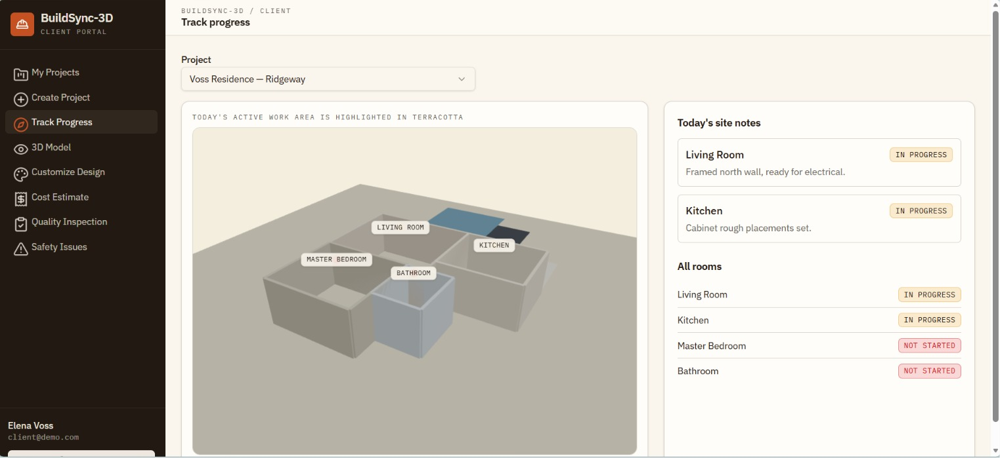
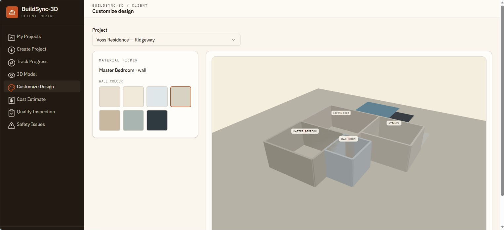

## Features

**Client**
- Create a project with a cost estimate and upload a floor plan
- Interactive 3D model generated from the uploaded blueprint
- Customize wall colours, floor tiles and cupboard styles, with live 3D preview
- Track daily progress, with the active work area shown in 3D
- Daily and monthly cost views, quality inspection results, safety reports
- Private chat with the contractor

**Contractor (Admin)**
- Approve or reject project requests, set timelines and milestones
- Create supervisor accounts, activate or deactivate users
- Create cost estimates, set budgets, review daily expenses
- Review quality and safety reports, message clients and supervisors

**Supervisor**
- Upload daily progress with photos, log daily costs
- Record quality inspections and safety incidents
- Project analytics (completion rate, delays, budget vs actual)

## How the blueprint-to-3D pipeline works

```
Floor plan image → OpenCV (Python) → room polygons (JSON) → MySQL → Three.js geometry
```

1. The image is thresholded so walls and room interiors separate.
2. Connected-components analysis finds each enclosed region. The region touching the image border is the exterior and is discarded.
3. Each room contour is simplified into a polygon and scaled to metres.
4. The frontend extrudes each polygon into a floor mesh and wall meshes.

**Scope note:** this is a classical computer vision pipeline (rule-based, no trained
model). It works best on clean, digitally drawn plans with dark walls on a light
background. Scanned, hand-drawn, or heavily annotated plans may not parse correctly.
Learned floor-plan parsing (e.g. CubiCasa5K, RoomFormer) is planned as future work.

## Tech stack

| Layer | Technology |
|---|---|
| Frontend | React 18, TypeScript, Vite, TanStack Router, Tailwind CSS, shadcn/ui |
| 3D | Three.js, React Three Fiber |
| Backend | Node.js, Express, Zod, Multer |
| Auth | JWT, bcrypt, role-based access control |
| Database | MySQL / MariaDB |
| CV pipeline | Python, OpenCV, NumPy |

## Project structure

```
├── src/                  # React frontend
│   ├── components/       # Scene3D, layout shells, UI components
│   ├── routes/           # File-based routes (client / contractor / supervisor)
│   └── lib/              # api.ts, store.tsx, types.ts
├── backend/
│   ├── src/              # Express app: routes, middleware, services, config
│   ├── cv/               # OpenCV blueprint parser (Python)
│   └── scripts/          # End-to-end API test
├── database/             # schema.sql, seed.sql
└── docs/
```

## System architecture

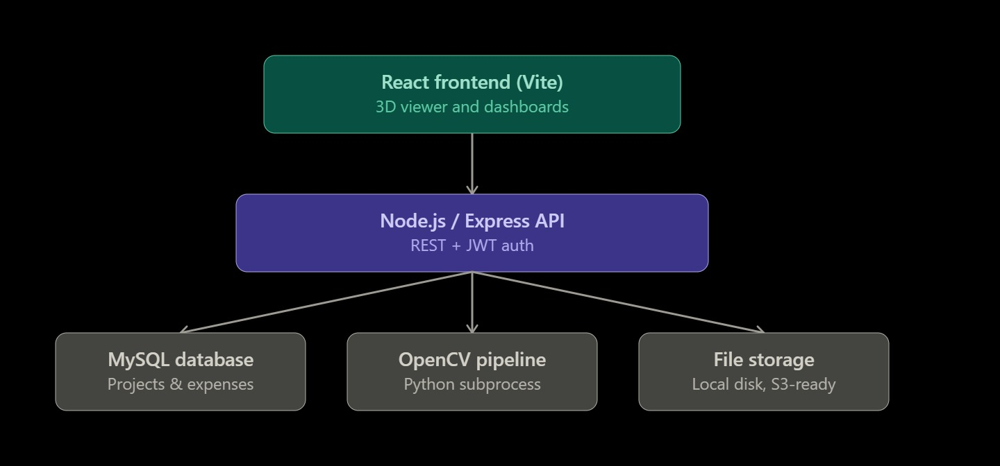
## Getting started

### Prerequisites
Node.js 18+, MySQL or MariaDB, Python 3.10+

### 1. Database
```bash
mysql -u root -p -e "CREATE DATABASE buildsync3d"
mysql -u root -p buildsync3d < database/schema.sql
mysql -u root -p buildsync3d < database/seed.sql
```

### 2. CV pipeline
```bash
cd backend/cv
python -m venv .venv
.venv\Scripts\activate          # Windows  (macOS/Linux: source .venv/bin/activate)
pip install -r requirements.txt
```

### 3. Backend
```bash
cd backend
npm install
cp .env.example .env            # then edit values (see below)
npm run dev                     # http://localhost:4000
```

### 4. Frontend
```bash
# from the project root
npm install
cp .env.example .env
npm run dev                     # http://localhost:8080
```

### Environment variables

`backend/.env`
```env
PORT=4000
CORS_ORIGIN=http://localhost:8080
DB_HOST=localhost
DB_USER=root
DB_PASSWORD=
DB_NAME=buildsync3d
JWT_SECRET=<long-random-string>
PYTHON_BIN=python        # use "py" on Windows if "python" isn't on PATH
CV_MOCK=false            # true returns a fixed layout and ignores the uploaded image
```

`.env` (frontend)
```env
VITE_API_BASE_URL=http://localhost:4000/api
```

## Demo accounts

Password for all: `demo`

| Role | Email |
|---|---|
| Client | client@demo.com |
| Contractor | contractor@demo.com |
| Supervisor | supervisor@demo.com |

Public registration creates Client accounts only. Supervisors are created by the contractor.

## Testing

With the database running:
```bash
cd backend
node scripts/e2e_test.mjs
```
Covers registration, login, project creation and approval, blueprint upload, room customization, quality/safety reports, messaging, and supervisor assignment.

## Known limitations

- Blueprint parsing is rule-based and limited to clean digital plans (see above).
- Generated 3D rooms are extruded boxes, not detailed architectural models.
- Login session is not restored after a page refresh.

## Developer

Charuka Lakshan
- GitHub: @charuka-dev
- LinkedIn: Charuka Lakshan<!-- Add names / GitHub profiles of your 4 members -->

## License

MIT

---

## Screenshots

### Client portal

<details open>
<summary><b>View all 10 client pages</b></summary>
<br>

| | |
|---|---|
| 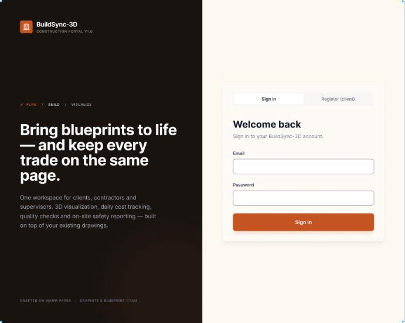 | 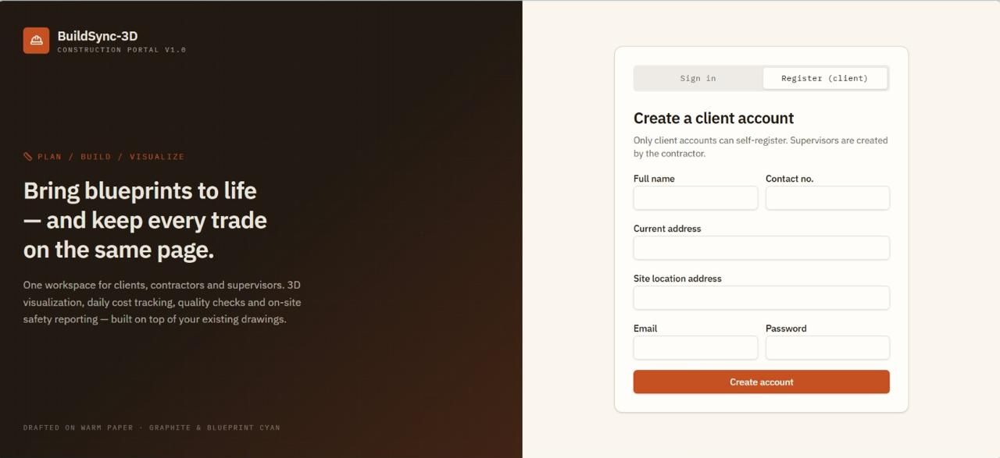 |
| **Login** | **Register** |
| 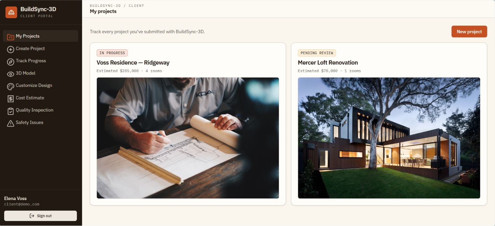 | 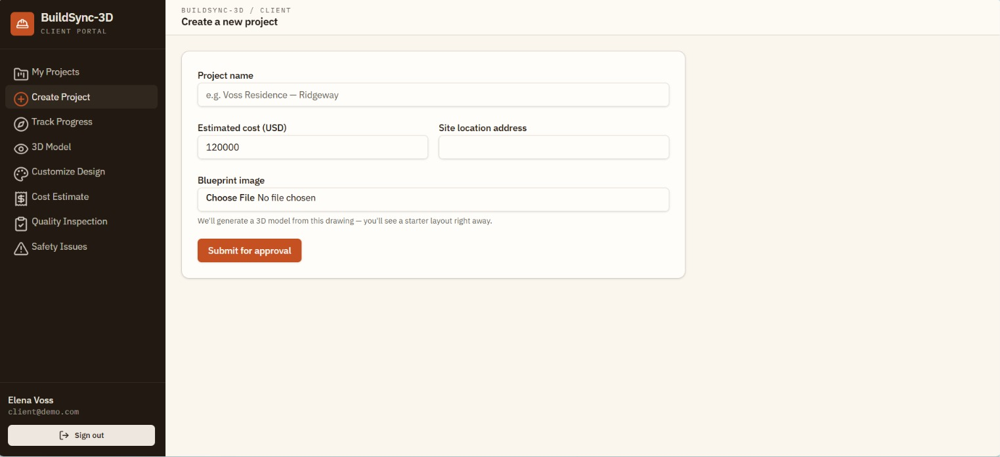 |
| **Dashboard** | **Create project** |
|  | 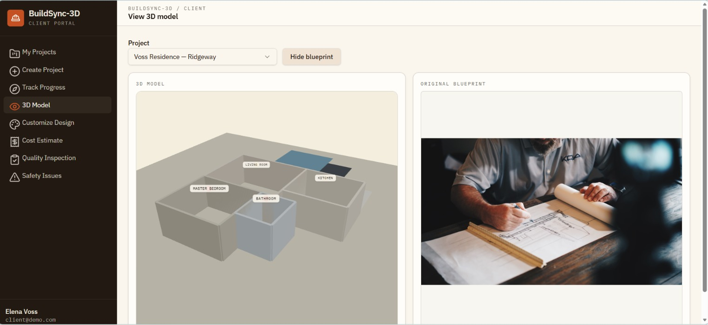 |
| **Track progress** | **3D model** |
|  | 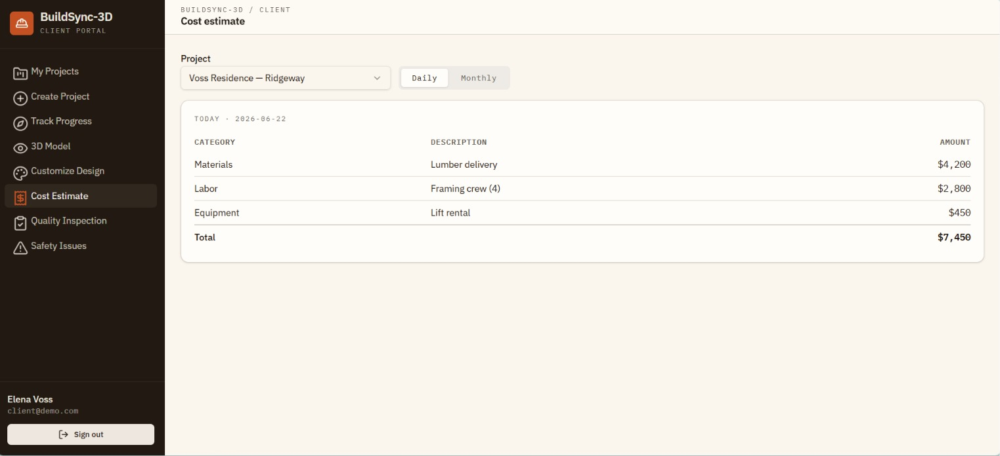 |
| **Customize design** | **Cost estimate** |
| 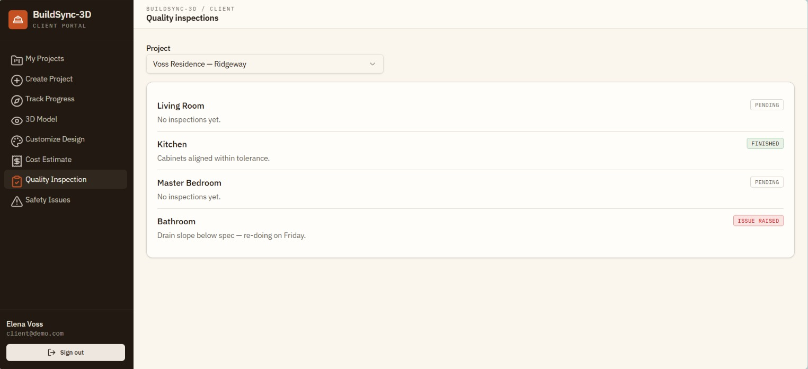 | 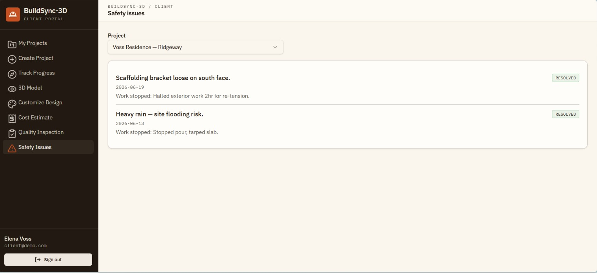 |
| **Quality inspection** | **Safety issues** |

</details>

### Contractor portal

<details>
<summary><b>View all 6 contractor pages</b></summary>
<br>

| | |
|---|---|
| 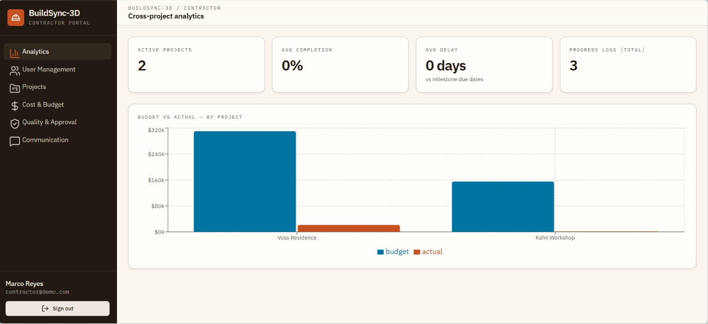 | 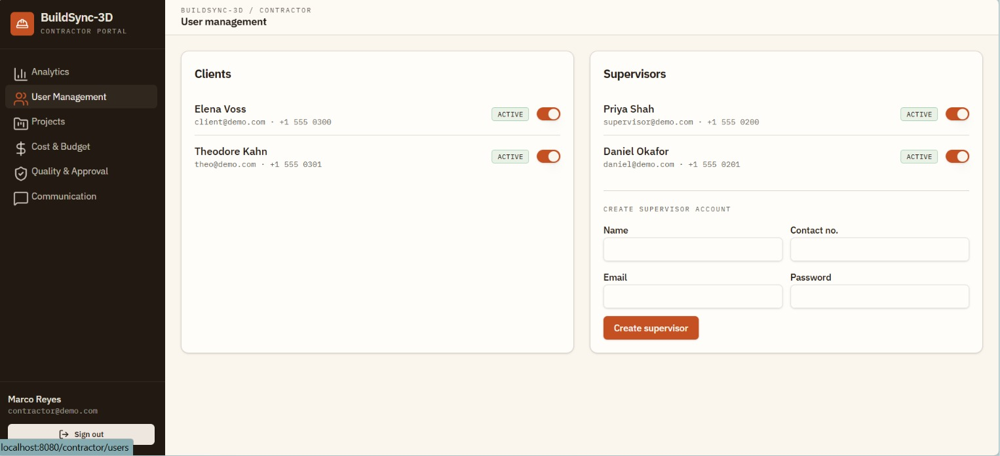 |
| **Dashboard** | **User management** |
| 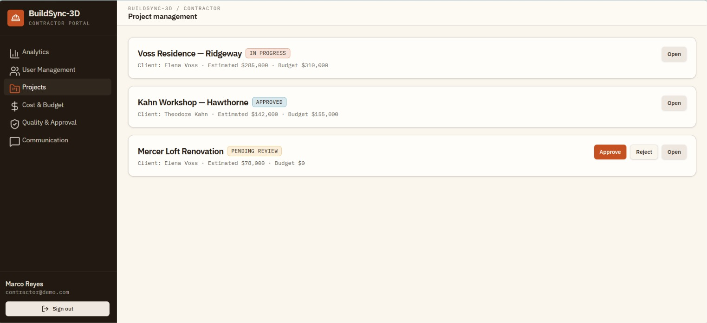 | 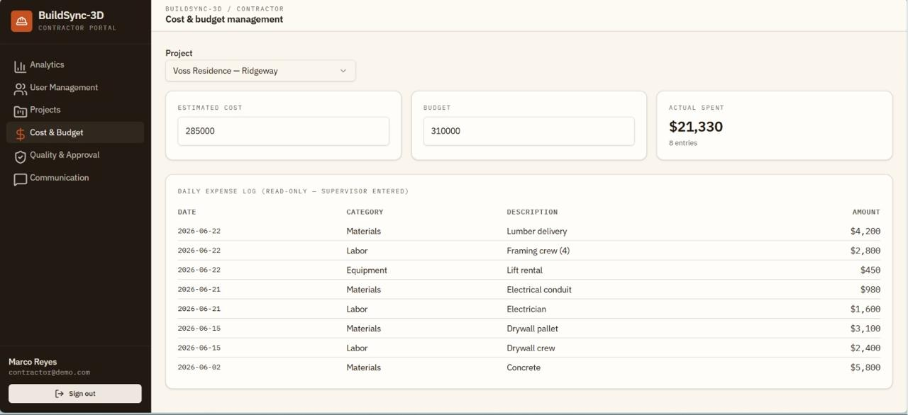 |
| **Project management** | **Cost & budget** |
| 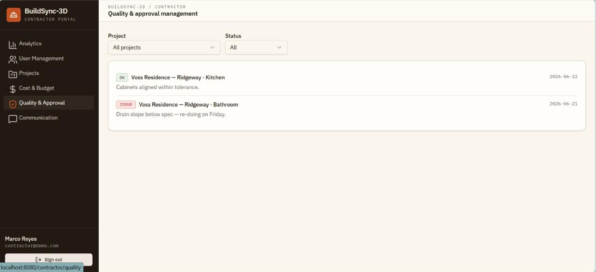 | 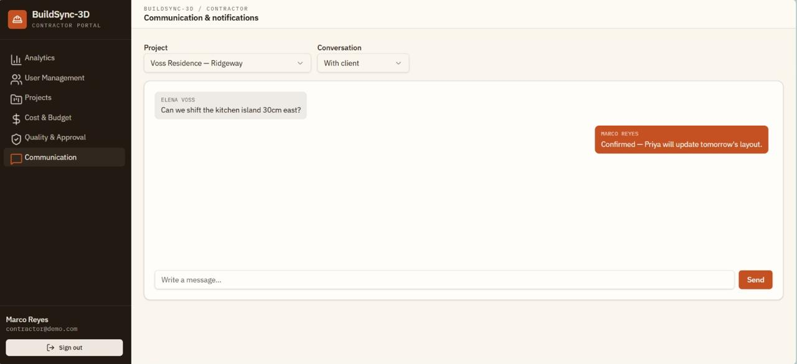 |
| **Quality & approval** | **Communication** |

</details>

### Supervisor portal

<details>
<summary><b>View all 6 supervisor pages</b></summary>
<br>

| | |
|---|---|
| 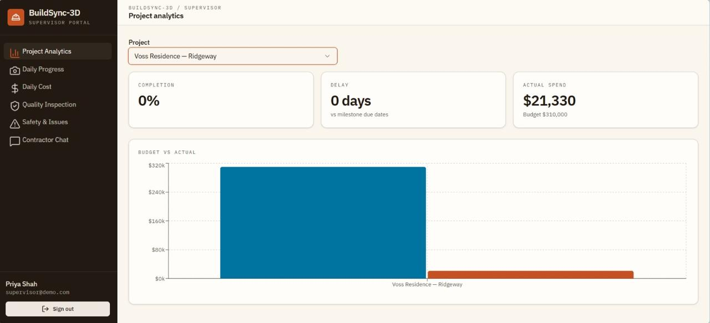 | 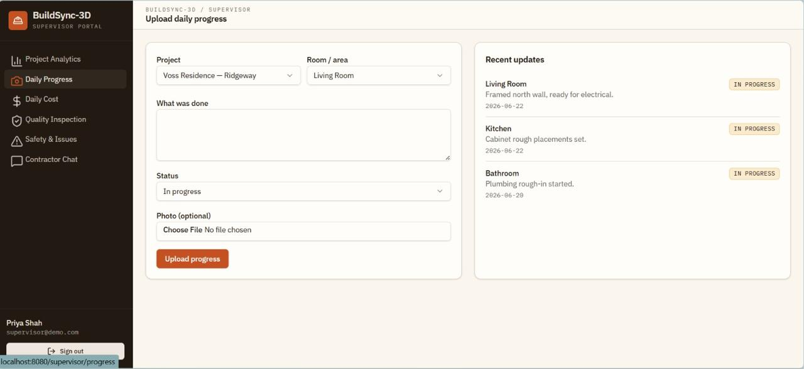 |
| **Dashboard** | **Daily progress** |
| 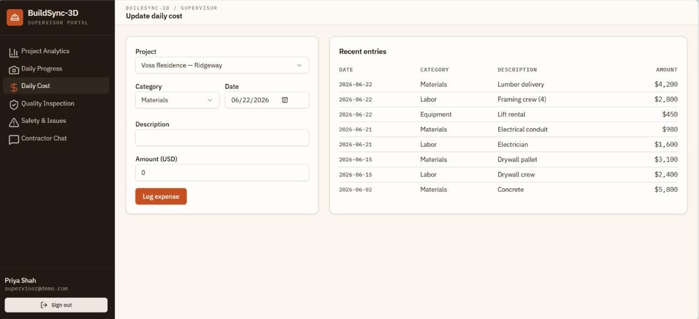 | 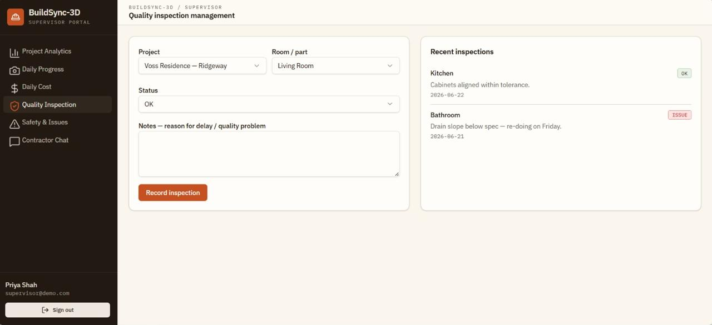 |
| **Daily cost** | **Quality inspection** |
| 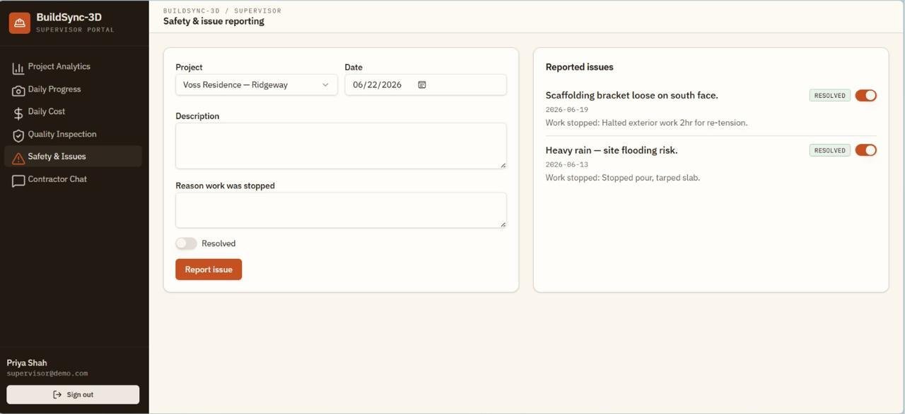 | 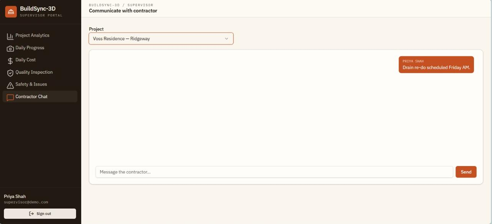 |
| **Safety issues** | **Contractor chat** |

</details>
